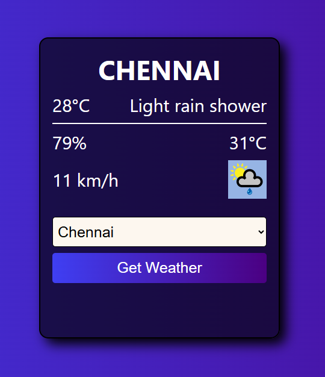

# Weather App

This is a clean, easy to use, responsive web application for finding the weather of Indian cities from different states. It provides real-time weather updates of the respective city selected. Build to deliver fast and accurate  meteorological data with a modern user interface.

## ✨ Features

- **Real-Time Weather:** View current temperature, "feels like" temperature, humidity, wind speed, and atmospheric pressure.
- **City Search:** Instantly search and fetch weather data for major cities in India.
- **Responsive Design:** Optimized for desktop, tablet, and mobile screens.
- **Easy to Use:** The UI is simple, clean and easy to use.

## 🛠️ Tech Stack

- **Frontend:** HTML5, CSS3, JavaScript (ES6+)
- **API:** [Weather API](https://wttr.in)
- **Deployment:** Netlify

## 📄 License

This project is licensed under the [MIT License](LICENSE).
